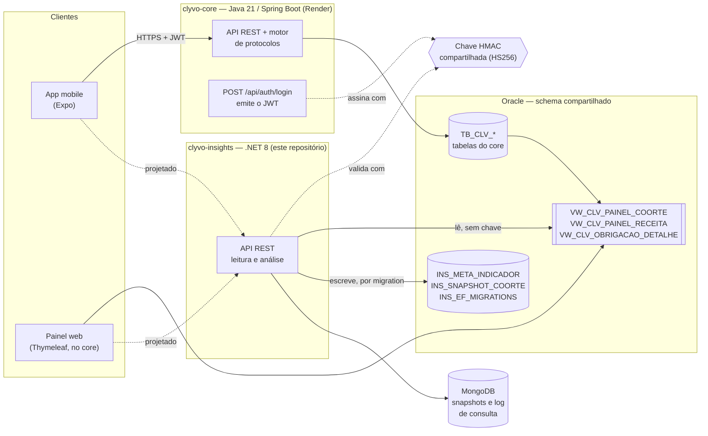
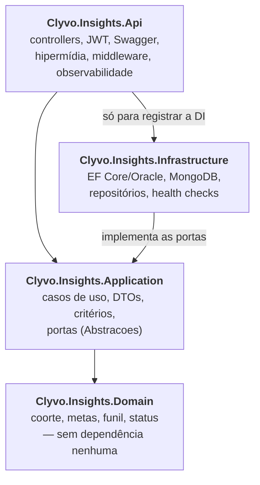

# Clyvo Insights — serviço .NET de leitura e análise

Serviço ASP.NET Core 8 do ecossistema **Clyvo Vet**. Ele é o lado de *leitura* e
existe para responder uma pergunta que o motor clínico não responde: **quanto da
receita da clínica é atribuível ao produto, e não à inércia dos tutores.**

A resposta sai da comparação entre o grupo tratado e um grupo de controle de
~10% dos pets, sorteado de forma determinística por hash e efetivamente não
perseguido pelo motor. A diferença entre as duas taxas de cumprimento é o efeito
do produto; o resto teria acontecido de qualquer jeito.

O motor de protocolos vive no `clyvo-core` (Java 21 / Spring Boot sobre Oracle,
com PL/SQL como implementação das regras). **Este serviço não escreve no domínio
clínico.** Ele lê as views que o core publica e governa por migration apenas as
próprias tabelas, prefixadas `INS_`. **A integração entre os dois é a view, não
HTTP.**

Versão atual: **v1.2.0** (Sprint 4).

## Integrantes

| RM | Nome |
|---|---|
| RM561940 | Pedro Henrique Dias França |
| RM562248 | Felipe Conte |
| RM562906 | Altamir Lima |
| RM563558 | Olavo Porto Neves |
| RM564495 | Luiz Gustavo Gonçalves |

## Sumário

- [Mapa da ementa](#mapa-da-ementa)
- [Funcionalidades](#funcionalidades)
- [Arquitetura](#arquitetura)
- [Contrato de integração com o core](#contrato-de-integração-com-o-core)
- [Endpoints](#endpoints)
- [Instalação e configuração](#instalação-e-configuração)
- [Testes e cobertura](#testes-e-cobertura)
- [Monitoramento](#monitoramento)

---

## Mapa da ementa

| Item da ementa de .NET | Onde está |
|---|---|
| Clean Architecture | 4 projetos em `src/` com dependência para dentro — [diagrama de camadas](#camadas-do-insights) |
| SOLID | Caso de uso com um método público (`Application/*/*.cs`); portas segregadas por necessidade (`ILeituraDoCoreRepository` agregada × `IDetalheObrigacaoRepository` paginada); Api e Infrastructure dependem de abstrações da Application |
| Injeção de dependência | `AddApplication` (`Application/InjecaoDeDependencia.cs`), `AddInfrastructure` (`Infrastructure/InjecaoDeDependencia.cs`), registros da Api em `Program.cs` |
| Tratamento global de exceção | `Api/Middlewares/ManipuladorGlobalDeExcecoes.cs` — `ProblemDetails` com `traceId` e `correlationId`, 400/404/409/500 |
| Swagger atualizado | `/swagger`; comentários XML da Api e da Application, `ProducesResponseType` em todos os endpoints, exemplos com `_links` em `Api/Swagger/` |
| Paginação, ordenação e filtros | `GET /api/insights/obrigacoes` — critérios em `Application/Obrigacoes/CriteriosListagemObrigacoes.cs`, `Skip/Take` no banco em `Infrastructure/Persistencia/Repositorios/DetalheObrigacaoRepository.cs` |
| HATEOAS nos endpoints de consulta | Todos os GET com `_links`, montados por `Api/Hipermidia/GeradorDeLinks.cs` — [exemplo](#exemplo-de-resposta-com-hateoas) |
| JWT | `Program.cs` (validação HS256 com a chave do core), `Api/Autenticacao/TenantContextHttp.cs` (tenant só do token) |
| EF Core com migrations | `Infrastructure/Persistencia/Migrations/` — três migrations, histórico em `INS_EF_MIGRATIONS` |
| MongoDB | `Infrastructure/Mongo/` — snapshots e log de consulta |
| Repositórios concretos (padrão Repository) | `Infrastructure/Persistencia/Repositorios/` (`LeituraDoCoreRepository`, `DetalheObrigacaoRepository`, `MetaIndicadorRepository`) e `Infrastructure/Mongo/ProjecaoRepository.cs` |
| Health checks | `/health` e `/health/ready` — `Infrastructure/Saude/` |
| Log estruturado | Serilog em JSON compacto, console e arquivo — [Logs](#logs) |
| xUnit no padrão AAA | `tests/` — 140 unitários e 66 de integração, `MetodoTestado_Cenario_ResultadoEsperado` |
| Cobertura de Domínio e Aplicação | Domain 96,6% e Application 98,7% de linhas — [docs/cobertura/Summary.md](docs/cobertura/Summary.md) |
| README: visão geral, arquitetura, endpoints, instalação, testes, integrantes | Este arquivo |
| Diagrama de arquitetura | [Arquitetura](#arquitetura), em Mermaid |

---

## Funcionalidades

- **Análise de coorte** — delta em pontos percentuais entre tratado e controle,
  consultas atribuíveis e receita recuperada, com os casos de borda tratados
  explicitamente (controle vazio, delta negativo, ticket ausente).
- **Listagem de obrigações** — paginada, filtrável e ordenável no banco, com
  links de navegação que preservam a consulta.
- **Resumo de obrigações** — distribuição por estado final, em baldes
  exclusivos, convertida do funil cumulativo que a view publica.
- **Metas de indicador** — CRUD completo sobre tabela própria, com as metas
  confrontadas com o valor apurado dentro da própria análise.
- **HATEOAS** — todo GET devolve `_links`; as ações de meta trazem o método.
- **Projeções** — série diária de snapshots no Oracle e documento completo no
  MongoDB.
- **Observabilidade** — log estruturado em JSON com correlação por requisição,
  tracing e métricas do OpenTelemetry, health checks separando vida de
  prontidão, e métricas de desempenho em endpoint próprio.

---

## Arquitetura

### Solução

Linha cheia é o que está **construído**; linha tracejada é **projetado** e ainda
não existe no código.



- O core é dono das tabelas `TB_CLV_*` e publica as três views como contrato.
  O insights **lê** as views e **escreve** só em `INS_*` e no Mongo.
- O JWT é emitido pelo core e validado **localmente** pelo insights com a mesma
  chave — o insights não chama o core para responder nenhuma requisição.
- **Projetado:** o app mobile e o painel ainda não consomem a API do insights. O
  painel lê a view direto; quando migrar, a consulta do lado Java sai do código
  para não ficarem duas implementações do mesmo número.

### Camadas do insights

As setas são dependências de compilação e apontam para dentro.



`Domain` não referencia ninguém. `Application` referencia só `Domain` e declara
as portas (`IDetalheObrigacaoRepository`, `IMetaIndicadorRepository`...).
`Infrastructure` implementa essas portas. A `Api` conhece a `Infrastructure`
apenas para chamar `AddInfrastructure` no `Program`; controllers e casos de uso
só falam com abstrações. Trocar Oracle por outro banco não toca em `Domain` nem
em `Application`.

```
Clyvo.Insights.sln
├─ src/
│  ├─ Clyvo.Insights.Domain
│  ├─ Clyvo.Insights.Application
│  ├─ Clyvo.Insights.Infrastructure
│  └─ Clyvo.Insights.Api
├─ tests/
│  ├─ Clyvo.Insights.Tests.Unit          140 testes
│  └─ Clyvo.Insights.Tests.Integration   66 testes (12 exigem banco)
├─ scripts/cobertura.ps1 · cobertura.sh
└─ docs/cobertura/Summary.md
```

Sem MediatR, sem AutoMapper, sem biblioteca de HATEOAS. Caso de uso é classe com
um método público; mapeamento é método de extensão escrito à mão; os links saem
do `LinkGenerator` do ASP.NET Core. A única dependência de conveniência é o Moq,
nos testes.

### Onde mora a regra

O cálculo é puro e vive no `Domain`:

- **`Coorte`** — grupo, obrigações resolvidas, obrigações cumpridas. A taxa é
  *derivada*, nunca recebida pronta.
- **`AnaliseCoorte`** — recebe as duas coortes e o ticket médio e produz delta em
  pontos percentuais, consultas atribuíveis e receita recuperada.
- **`ResumoObrigacoes`** — converte o funil cumulativo da view em baldes
  exclusivos por estado.
- **`MetaIndicador`** — o piso que a clínica define para um indicador.
- **`StatusObrigacao`** — o vocabulário de estados do core, na ordem do funil.

**O denominador é só o que já foi resolvido.** Obrigação que ainda não venceu não
é falta: ela nem teve a chance. Contá-la afundaria as duas taxas e faria o número
andar sozinho com o calendário. A decisão está tomada do lado Oracle, na
`VW_CLV_PAINEL_COORTE`, e o Domínio a preserva como invariante.

---

## Contrato de integração com o core

| Objeto | Natureza | Quem é dono | Criado em |
|---|---|---|---|
| `VW_CLV_PAINEL_COORTE` | view, leitura | core | migration V11 do core |
| `VW_CLV_PAINEL_RECEITA` | view, leitura | core | migration V7 do core |
| `VW_CLV_OBRIGACAO_DETALHE` | view, leitura | core | migration V16 do core |
| `INS_META_INDICADOR` | tabela, escrita | insights | `CriaMetaIndicador` |
| `INS_SNAPSHOT_COORTE` | tabela, escrita | insights | `CriaSnapshotCoorte` |
| `INS_EF_MIGRATIONS` | tabela, controle | insights | EF Core |

`VW_CLV_OBRIGACAO_DETALHE` tem **uma linha por obrigação**, com contrato de
colunas fixo:

| Coluna | Tipo | Observação |
|---|---|---|
| `ID_OBRIGACAO` | NUMBER | desempate da ordenação |
| `ID_CLINICA` | NUMBER | recorte de tenant — a view não filtra |
| `ID_PET` | NUMBER | filtro `pet` |
| `NM_PET` | VARCHAR2 | ordenação `pet` |
| `NM_TUTOR` | VARCHAR2 | só o nome: a view não publica contato |
| `NM_PROTOCOLO` | VARCHAR2 | |
| `DS_CATEGORIA` | VARCHAR2 | filtro `categoria` |
| `NM_ETAPA` | VARCHAR2 | |
| `DS_STATUS` | VARCHAR2 | filtro e ordenação `status` |
| `FL_GRUPO_CONTROLE` | CHAR(1) | `S` controle, `N` tratado — filtro `grupo` |
| `DT_PREVISTA` | DATE | filtros `de`/`ate`, ordenação padrão |
| `DT_JANELA_INICIO` | DATE | |
| `DT_JANELA_FIM` | DATE | |
| `NR_VALOR_ESTIMADO` | NUMBER(10,2) | ordenação `valorEstimado` |
| `NR_VALOR_REALIZADO` | NUMBER(10,2) | |

### Por que as views não aparecem nas migrations

As views entram como entidades sem chave, mapeadas com
`HasNoKey().ToView("VW_CLV_...")`, e o EF Core não emite DDL para entidades
mapeadas com `ToView`. Isso é intencional: **migrations governam só o que este
serviço é dono, e o resto é leitura sobre contrato publicado.** A migration
`MapeiaVwObrigacaoDetalhe` tem `Up` e `Down` vazios — ela existe para o snapshot
do modelo registrar a terceira view. Um teste de infraestrutura confere que o
script gerado tem as tabelas `INS_` e nenhuma das views.

O prefixo `INS_` não é decorativo: o schema Oracle é compartilhado com as
tabelas `TB_CLV_` do core, e é ele que evita colisão. Pelo mesmo motivo a tabela
de histórico do EF foi renomeada de `__EFMigrationsHistory` para
`INS_EF_MIGRATIONS`.

### MongoDB

Guarda os snapshots apurados e o log de consulta de indicadores. A justificativa
é a forma, não a velocidade: o documento de snapshot muda conforme as metas que a
clínica tenha definido, e versionar isso em coluna relacional pediria migration a
cada indicador novo. **O Mongo não é cache do Oracle** — nada do que é gravado
nele volta a ser lido para responder requisição.

---

## Endpoints

| Método | Rota | Resposta | `_links` |
|---|---|---|---|
| GET | `/api/insights/coorte` | 200 / 401 / 403 | `self`, `obrigacoesTratamento`, `obrigacoesControle` |
| GET | `/api/insights/obrigacoes` | 200 / 400 / 401 | `self`, `first`, `prev`, `next`, `last`; `self` em cada item |
| GET | `/api/insights/obrigacoes/{id}` | 200 / 401 / 404 | `self` |
| GET | `/api/insights/obrigacoes/resumo` | 200 / 401 | `self` e um por balde do funil |
| GET | `/api/insights/metas` | 200 / 401 | `self`, `criar` (POST); em cada meta `self`, `atualizar` (PUT), `remover` (DELETE) |
| GET | `/api/insights/metas/{id}` | 200 / 401 / 404 | `self`, `atualizar`, `remover` |
| POST | `/api/insights/metas` | 201 / 400 / 409 | os da meta; `Location` aponta para `GET metas/{id}` |
| PUT | `/api/insights/metas/{id}` | 200 / 400 / 404 | os da meta |
| DELETE | `/api/insights/metas/{id}` | 204 / 404 | — |
| GET | `/health` | 200 — vivo | — |
| GET | `/health/ready` | 200 — pronto | — |
| GET | `/metrics` | 200 — desempenho | — |

**Nenhum endpoint recebe o id da clínica pelo cliente.** O tenant sai do claim
`idClinica` do token emitido pelo core e entra em toda consulta. Recurso de outra
clínica responde **404**, a mesma resposta de recurso inexistente — distinguir os
dois confirmaria que aquele id existe em algum lugar.

Swagger em `/swagger`, com esquema Bearer, os parâmetros de consulta documentados
e exemplos de resposta com `_links`.

### Listagem de obrigações

`GET /api/insights/obrigacoes` — todos os parâmetros são opcionais e combináveis.

| Parâmetro | Valores | Padrão |
|---|---|---|
| `pagina` | 1 em diante | 1 |
| `tamanho` | 1 a 100 | 20 |
| `status` | `PREVISTA`, `NOTIFICADA`, `RESPONDIDA`, `AGENDADA`, `CUMPRIDA`, `PERDIDA`, `CANCELADA` (sem diferenciar caixa) | — |
| `grupo` | `tratamento` ou `controle` | — |
| `categoria` | categoria do protocolo (`VACINA`, `VERMIFUGO`, `EXAME`...) | — |
| `de`, `ate` | `AAAA-MM-DD`, inclusivos, sobre a data prevista | — |
| `pet` | id do pet | — |
| `ordenarPor` | `dataPrevista`, `status` (ordem do funil), `pet` (nome), `valorEstimado` | `dataPrevista` |
| `direcao` | `asc` ou `desc` | `asc` |

- **Tudo no banco.** Filtro, ordenação e `Skip`/`Take` são aplicados no
  `IQueryable`, e `totalItens` é o `COUNT` da mesma consulta filtrada.
- **Ordem estável.** Toda ordenação desempata por `ID_OBRIGACAO`, então a mesma
  consulta corta sempre as mesmas páginas.
- **Lista branca.** Campo de ordenação fora da lista responde 400 — o parâmetro
  nunca vira `ORDER BY` livre.
- **Erros juntos.** Parâmetro inválido responde 400 com `ProblemDetails` e todos
  os erros em `errors`, por nome de parâmetro.
- **Navegação.** Os links de página repetem filtros e ordenação; `prev` some na
  primeira página e `next` na última. Página além da última responde 200 com
  `itens` vazio e `prev` apontando para a última.

### Exemplo de resposta com HATEOAS

`GET /api/insights/obrigacoes?status=CUMPRIDA&pagina=2` (resumido a um item):

```json
{
  "itens": [
    {
      "id": 62016,
      "idPet": 10722,
      "nomePet": "Rex",
      "nomeTutor": "Silva Silva",
      "protocolo": "Profilaxia dentaria felina",
      "categoria": "ODONTO",
      "etapa": "Avaliacao odontologica",
      "status": "CUMPRIDA",
      "grupo": "TRATADO",
      "dataPrevista": "2025-05-05",
      "janelaInicio": "2025-04-20",
      "janelaFim": "2025-07-04",
      "valorEstimado": 150,
      "valorRealizado": 150,
      "_links": { "self": { "href": "http://localhost:8081/api/insights/obrigacoes/62016" } }
    }
  ],
  "pagina": 2,
  "tamanho": 20,
  "totalItens": 1759,
  "totalPaginas": 88,
  "_links": {
    "self":  { "href": "http://localhost:8081/api/insights/obrigacoes?pagina=2&tamanho=20&status=CUMPRIDA&ordenarPor=dataPrevista&direcao=asc" },
    "first": { "href": "http://localhost:8081/api/insights/obrigacoes?pagina=1&tamanho=20&status=CUMPRIDA&ordenarPor=dataPrevista&direcao=asc" },
    "prev":  { "href": "http://localhost:8081/api/insights/obrigacoes?pagina=1&tamanho=20&status=CUMPRIDA&ordenarPor=dataPrevista&direcao=asc" },
    "next":  { "href": "http://localhost:8081/api/insights/obrigacoes?pagina=3&tamanho=20&status=CUMPRIDA&ordenarPor=dataPrevista&direcao=asc" },
    "last":  { "href": "http://localhost:8081/api/insights/obrigacoes?pagina=88&tamanho=20&status=CUMPRIDA&ordenarPor=dataPrevista&direcao=asc" }
  }
}
```

Uma meta, com as ações e o método de cada uma:

```json
{
  "id": 61,
  "indicador": "TaxaCumprimento",
  "limiarPercentual": 55,
  "dataCriacao": "2026-10-29T00:05:56.345Z",
  "dataAtualizacao": "2026-10-29T00:05:56.345Z",
  "_links": {
    "self":      { "href": "http://localhost:8081/api/insights/metas/61" },
    "atualizar": { "href": "http://localhost:8081/api/insights/metas/61", "method": "PUT" },
    "remover":   { "href": "http://localhost:8081/api/insights/metas/61", "method": "DELETE" }
  }
}
```

Os links são absolutos e usam o esquema e o host da requisição. Saem todos de um
componente só, o `GeradorDeLinks`, que resolve a URL pelo **nome** da rota — mudar
o template de uma rota não deixa link quebrado. Os DTOs da Aplicação não sabem de
link: o `Recurso<T>` da Api os embrulha e serializa achatado, com `_links` ao
lado dos campos.

No resumo, cada balde tem um link com o nome do campo para a listagem filtrada
pelo status correspondente e limitada às vencidas (`ate` = ontem, o mesmo corte
da view). `naoTrabalhadas` soma PREVISTA e CANCELADA, e por isso tem dois links.

### Autenticação

JWT compartilhado com o core: mesma chave simétrica, HS256 sobre os bytes UTF-8
do segredo. O insights **não emite** token, só valida o que o core emitiu. O core
não preenche issuer nem audience, então `ValidateIssuer` e `ValidateAudience`
ficam desligados de propósito — deixá-los no padrão recusaria todo token legítimo
com 401. A policy padrão exige o claim `idClinica` (403 sem ele).

Obtenha um token no core (usuário de demonstração do seed do core):

```bash
curl -X POST http://localhost:8080/api/auth/login \
  -H "Content-Type: application/json" \
  -d '{"email":"patricia@vidaanimal.com.br","senha":"<senha do usuário de demonstração>","tipo":"COLABORADOR"}'
```

---

## Instalação e configuração

Pré-requisitos: .NET 8 SDK (ou superior com o targeting pack do net8.0), o
Oracle do core com as migrations até a **V16** aplicadas, e MongoDB. O jeito mais
simples de ter os dois é o compose do core mais o deste repositório.

### Configuração

**Segredo nenhum é versionado.** O `appsettings.json` leva a connection string e
a chave JWT **vazias**; os valores vêm de variável de ambiente ou, em
desenvolvimento, de `dotnet user-secrets` (guardados no perfil do usuário, fora
do repositório).

| Variável | Obrigatória | Para quê |
|---|---|---|
| `ConnectionStrings__Oracle` | sim | Oracle do core. Ex.: `User Id=petflow;Password=<senha>;Data Source=localhost:1521/PETFLOWDB` |
| `Jwt__Secret` | sim | **a mesma** chave HMAC do core (`JWT_SECRET`) |
| `Mongo__ConnectionString` | não¹ | MongoDB das projeções |
| `Core__BaseUrl` | não | clyvo-core, só para a sonda de disponibilidade |
| `Serilog__Arquivo` | não | caminho do log em arquivo |

¹ Sem Mongo a API responde normalmente; só as projeções de saída deixam de ser
gravadas e `/health/ready` sai *Degraded*.

A aplicação **recusa a subir** sem `ConnectionStrings__Oracle` ou sem
`Jwt__Secret`, com uma mensagem dizendo qual variável definir. Não há valor
padrão para nenhuma das duas — em particular, nenhum que aponte para o Oracle da
FIAP.

### Com Docker

O compose deste repositório sobe o Mongo e a API .NET, e entra na rede que o
compose do core já cria. As senhas vêm de um `.env` ao lado do
`docker-compose.yaml` (ignorado pelo Git): copie o `.env.example` e preencha com
os valores do compose do core. Variável ausente faz o compose recusar a subir.

```bash
cd ../../Clyvo-Vet.java/server && docker compose up -d
cd -
cp .env.example .env            # e preencha
docker compose up -d
```

API em `http://localhost:8081`, Swagger em `http://localhost:8081/swagger`.

### Local

Uma vez por máquina, guarde os segredos nos *user-secrets*:

```bash
cd src/Clyvo.Insights.Api
dotnet user-secrets set "ConnectionStrings:Oracle" "User Id=petflow;Password=<senha>;Data Source=localhost:1521/PETFLOWDB"
dotnet user-secrets set "Jwt:Secret" "<mesma JWT_SECRET do core>"
dotnet user-secrets set "Mongo:ConnectionString" "mongodb://insights:<senha>@localhost:27017/?authSource=admin"
cd -
```

Depois:

```bash
dotnet restore
dotnet run --project src/Clyvo.Insights.Api
```

O perfil `http` do `launchSettings.json` sobe em `Development` na porta
`http://localhost:5240` e lê os *user-secrets*.

### Migrations

Migration é passo de deploy, não de inicialização: o container não altera schema
ao subir.

```bash
ConnectionStrings__Oracle="User Id=petflow;Password=<senha>;Data Source=localhost:1521/PETFLOWDB" \
dotnet ef database update \
  -p src/Clyvo.Insights.Infrastructure \
  -s src/Clyvo.Insights.Infrastructure
```

---

## Testes e cobertura

```bash
dotnet test
```

Roda a suíte inteira sem exigir banco nenhum e sem nenhuma variável definida:
**140 unitários + 54 de integração verdes, e 12 ignorados** — os que precisam de
infraestrutura real (veja abaixo). Com a infraestrutura habilitada, são **206
verdes e nenhum ignorado**.

```bash
dotnet test tests/Clyvo.Insights.Tests.Unit
dotnet test --filter "FullyQualifiedName~ListarObrigacoes"
```

### Cobertura

| Camada | Linhas | Ramos |
|---|---|---|
| **Domain** | **96,6%** | 95,8% |
| **Application** | **98,7%** | 98,2% |
| Api | 95,6% | 72,1% |
| Infrastructure | 4,4% | 5,7% |

Medida com o `coverlet.collector` dos csproj sobre a suíte sem infraestrutura,
consolidada pelo `reportgenerator` (ferramenta local, `.config/dotnet-tools.json`).
Nada é excluído da medição. A Infrastructure fica baixa porque, sem banco, quase
todo o código dela — repositórios EF, Mongo e as migrations geradas — só roda no
grupo protegido por variável. Resumo completo em
[docs/cobertura/Summary.md](docs/cobertura/Summary.md); para reproduzir:

```bash
./scripts/cobertura.ps1        # ou ./scripts/cobertura.sh
```

O HTML detalhado fica em `TestResults/cobertura/relatorio/index.html`, fora do Git.

### Organização

Nomes seguem `MetodoTestado_Cenario_ResultadoEsperado`, e cada teste separa
Arrange, Act e Assert visualmente.

**Unitários** cobrem os casos de borda da regra — coorte de controle vazia, delta
negativo preservado com sinal, degrau de funil fora de ordem —, os critérios da
listagem (limites de página e tamanho, ordenação fora da lista branca, combinação
de filtros), a aritmética de paginação, a montagem de links de primeira, meio e
última página com os filtros preservados, e a serialização de `_links`. Os casos
de uso usam **Moq** e verificam orquestração e recorte por tenant; o Domínio é
puro e não tem dublê.

**Integração** sobe a API em processo com `WebApplicationFactory` e repositórios
em memória: 401 sem token e com token de outra chave, 403 sem o claim de
clínica, 400 com o parâmetro inválido em `errors`, 404 para recurso de outra
clínica, envelope e links da listagem, `_links` em coorte, resumo e metas, e o
`swagger.json` descrevendo os parâmetros.

As fixtures dividem o host conforme quem escreve e quem só lê:

- `ColecaoDaApi` (`ICollectionFixture`) serve as classes que apenas leem — um
  host para todas, e a collection ainda serializa a execução delas;
- `MetasEndpointTests` usa `IClassFixture`, com host próprio, porque cria e apaga
  metas. O construtor limpa o estado antes de cada teste.

Os dados canônicos são fixados em fixture, e não lidos do seed: o seed do core
usa `SYS_GUID` e datas relativas a `SYSDATE`, então a contagem muda a cada
reexecução.

### Testes contra infraestrutura real

Um grupo exercita o Oracle e o MongoDB de verdade — é a classe de defeito que
dublê não pega. Fica **ignorado por padrão**: clone limpo sem banco tem de ter a
suíte verde, senão o vermelho deixa de significar "quebrou".

```bash
CLYVO_TESTES_DE_INFRA=1 \
ConnectionStrings__Oracle="User Id=petflow;Password=<senha>;Data Source=localhost:1521/PETFLOWDB" \
Mongo__ConnectionString="mongodb://insights:<senha>@localhost:27017/?authSource=admin" \
dotnet test
```

| Teste | O que guarda |
|---|---|
| `TaxaCumprimento_SobreAsLinhasDaView_BateComPcCumprimentoDaColuna` | A taxa derivada pelo Domínio contra o `PC_CUMPRIMENTO` da view |
| `SalvarAsync_ComMetaNova_DevolveDataEmUtcAoRelerDoOracle` | `DateTimeKind` sobrevive à ida e volta ao `TIMESTAMP` |
| `PainelCoorte_LidaDoOracle_TemAFormaDoContratoPublicado` | Colunas, rótulos de grupo e nulabilidade do ticket |
| `PainelReceita_LidaDoOracle_TemFunilMonotonicamenteDecrescente` | A invariante que o Domínio assume ao converter funil em baldes |
| `Migrations_NoOracle_EstaoAplicadasESemPendencia` | Modelo e banco não divergiram, incluindo `MapeiaVwObrigacaoDetalhe` |
| `Migrations_NoOracle_NaoGovernamAsViewsDoCore` | O DDL gerado tem as tabelas `INS_` e **nenhuma** das três views |
| `ListarDaClinicaAsync_NaViewReal_PaginaSemSobreporEContaOTotalDaClinica` | `OFFSET/FETCH` e `COUNT` sobre a `VW_CLV_OBRIGACAO_DETALHE` |
| `ListarDaClinicaAsync_ComFiltrosCombinados_BateComAConsultaDiretaAView` | Filtros traduzidos para SQL batem com a consulta direta |
| `ListarDaClinicaAsync_OrdenadoPorStatus_SegueAOrdemDoFunil` | O `CASE` da ordenação por status |
| `ObterDaClinicaAsync_ComObrigacaoDeOutraClinica_DevolveNulo` | Recorte por tenant no detalhe |
| `RegistrarSnapshotAsync_NoMongo_GravaDecimalComoDecimal128` | Decimal vai como número e o campo sai em camelCase |
| `RegistrarConsultaAsync_NoMongo_AcrescentaLinhaAoLogDeConsulta` | A escrita real pelo caminho de DI da API |

Os que escrevem limpam o que escrevem, em clínicas de teste (`999001`, `999002`)
que não existem no seed.

---

## Monitoramento

### Health checks

| Verificação | Aparece em | Falha como | Por quê |
|---|---|---|---|
| `self` | `/health` | — | Só diz que o processo responde |
| `oracle` | `/health/ready` | **Unhealthy** | Sem ele não há o que responder |
| `mongo` | `/health/ready` | Degraded | Só recebe projeção de saída |
| `clyvo-core` | `/health/ready` | Degraded | Não está no caminho de resposta |

**Vivo não é pronto.** `/health` não toca em banco nem em rede: se ele desse
unhealthy por Oracle fora, o orquestrador reiniciaria um processo saudável — e
reinício não traz banco de volta. Ambos são anônimos: quem sonda saúde é o
orquestrador, que não tem token do core.

```bash
curl -s http://localhost:8081/health/ready | jq
```

### Métricas de desempenho

`GET /metrics` agrega, via `MeterListener`, o histograma
`http.server.request.duration` que o próprio ASP.NET Core publica: requisições,
taxa de erro, respostas por faixa e duração média e máxima **por rota** (template,
não caminho — `/metas/7` e `/metas/9` são a mesma rota).

### Logs

Serilog em JSON compacto, nos **dois destinos**:

| Destino | Onde | Para quê |
|---|---|---|
| Console | stdout | O que o orquestrador coleta (`docker logs api-clyvoinsights`) |
| Arquivo | `logs/clyvo-insights-<data>.log` | Sobrevive ao container ser recriado |

Rotação diária, sete arquivos retidos, caminho configurável por
`Serilog:Arquivo`. **Níveis:** `Information` no ciclo de requisição, `Warning` em
requisição rejeitada e falha de projeção, `Error` em falha não tratada.

**Correlação.** Cada requisição carrega um `CorrelationId`, que é o mesmo
`TraceId` do OpenTelemetry — um único identificador liga log, span e resposta. Se
o chamador mandar `X-Correlation-Id`, esse valor é respeitado. A correlação sai no
cabeçalho da resposta e no corpo do `ProblemDetails`.

```bash
grep '"CorrelationId":"<valor>"' logs/clyvo-insights-*.log | jq
```

### Tracing

OpenTelemetry instrumenta ASP.NET Core, HttpClient e EF Core, mais métricas de
runtime, exportando para console. O health check é filtrado do tracing. Trocar o
exportador por OTLP é uma linha, no dia em que houver coletor.

---

## Fora de escopo nesta entrega

Ingestão de eventos por Service Bus e outbox. A migração do painel Thymeleaf e do
app mobile para consumir esta API (setas tracejadas no diagrama de solução).
